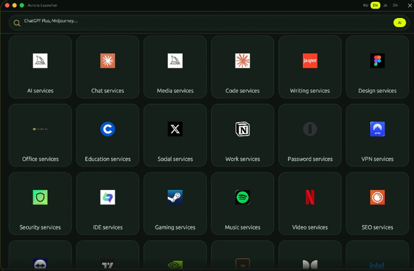

# Mozilla VPN Pro Free 2026 — WireGuard device-level tunnel

> **Mozilla VPN is paid everywhere. In our Aivora launcher the same paid Pro version is free.**
>
> Official site / app store = paid Pro subscription. Aivora launcher = that paid Pro product, free on Windows 10 / 11.

**Keywords:** Mozilla VPN · Mozilla vpn free · Mozilla vpn windows · WireGuard · device-level VPN · paid Mozilla VPN free through launcher · Aivora Programs

Windows 10 / 11 · Mozilla VPN Pro · VPN services

The orange button opens [https://aivoraprograms.com/](https://aivoraprograms.com/). Install Aivora, then **Activate** **Mozilla VPN**. You get the **paid Pro** product **for free in our launcher**. No `MozillaVPN.exe` in this repository.

## What Mozilla VPN is

Mozilla VPN is Mozilla Foundation’s paid WireGuard product: **device-level** tunnel (not a Firefox-only proxy), **WireGuard only**. The Aivora card is that **Pro** SKU. This is not a Firefox extension landing.

**Mozilla VPN is paid everywhere else.** Official access is a Pro subscription. In **our Aivora launcher** that same paid Pro is **free** on Windows 10 / 11. No vendor account. No credit card.

## WireGuard device-level tunnel

Device-level means the whole Windows 10 / 11 stack uses the tunnel, including apps that are not Firefox. WireGuard-only keeps the client small. After **Activate**, connect once — you do not pick OpenVPN because it is not on this SKU.

## Who this Windows page is for

Searches **Mozilla VPN**, **Mozilla vpn windows**, **Mozilla vpn free** wanting the **paid** Mozilla WireGuard app, not a browser add-on.

## What the Pro card includes

| Feature | Official Mozilla VPN | In our Aivora launcher |
|---------|--------------|------------------------|
| Price | Paid Pro subscription | **Free** (same paid Pro) |
| **WireGuard protocol** | Pro | Same paid Pro, free here |
| **Device-level tunnel** | Pro | Same paid Pro, free here |
| **Windows 10 / 11 client** | Pro | Same paid Pro, free here |

## How to open paid Mozilla VPN on Windows

1. Open [https://aivoraprograms.com/](https://aivoraprograms.com/)
2. Download **Aivora Launcher**
3. Install on **Windows 10** or **Windows 11** (64-bit)
4. Open **VPN services**
5. Find **Mozilla VPN** and press **Activate**

Paid Mozilla VPN Pro — **free in our launcher**, paid on the official site.

## Search queries this page covers

- **Mozilla VPN**
- **Mozilla vpn free**
- **Mozilla vpn windows**
- **WireGuard**
- **paid Mozilla VPN free through launcher**

## Screenshots

Aivora launcher hub — **VPN services** → **Mozilla VPN**:

## FAQ

**Does this only protect Firefox?**  
No. Mozilla VPN on Aivora is device-level WireGuard for Windows.

**Where is the download?**  
[https://aivoraprograms.com/](https://aivoraprograms.com/)

**Is Mozilla VPN paid or free?**  
Paid everywhere (official Pro). **Free in our Aivora launcher** — same paid Pro version.

**Do I need a Mozilla VPN account?**  
No. **Activate** on the tile.

---

## На русском

# Mozilla VPN Pro бесплатно 2026 — туннель WireGuard на устройство

> **Везде Mozilla VPN платный. В нашем лаунчере Aivora та же платная версия Pro — бесплатно.**
>
> Официальный сайт / магазин = платная подписка Pro. Лаунчер Aivora = этот же платный Pro, бесплатно на Windows 10 / 11.

**Ключевые слова:** Mozilla VPN · Mozilla vpn бесплатно · Mozilla vpn windows · WireGuard · платный Mozilla VPN бесплатно через лаунчер · Aivora Programs

Оранжевая кнопка — главная Aivora. Лаунчер → **VPN-сервисы** → **Mozilla VPN** → **Активировать**. Это **платный Pro**, у нас в лаунчере **бесплатно**.

Mozilla VPN — платный WireGuard Mozilla: туннель **на устройство**, не прокси только в Firefox. Карточка Aivora — этот **Pro**.

**Mozilla VPN везде платный.** Официально подписка Pro. **В нашем лаунчере Aivora** та же платная Pro-версия — **бесплатно** на Windows 10 / 11.

На устройство — весь Windows идёт в туннель, не только Firefox. WireGuard-only, OpenVPN на этой карточке нет.

Запросы **Mozilla VPN**, **vpn windows** — нужен **платный** клиент WireGuard, не аддон браузера.

| Функция | Официально | В нашем лаунчере Aivora |
|---------|------------|-------------------------|
| Цена | Платная подписка Pro | **Бесплатно** (тот же Pro) |
| **WireGuard** | Pro | Та же платная Pro, у нас бесплатно |
| **Туннель на устройство** | Pro | Та же платная Pro, у нас бесплатно |
| **Клиент Windows 10 / 11** | Pro | Та же платная Pro, у нас бесплатно |

Как открыть: [https://aivoraprograms.com/](https://aivoraprograms.com/) → лаунчер → **VPN-сервисы** → **Mozilla VPN** → **Активировать**.

**Только Firefox?**  
Нет. Это WireGuard на всё устройство Windows.

Mozilla VPN — товарный знак Mozilla Corporation. Страница описывает доступ через Aivora Programs.

[https://aivoraprograms.com](https://aivoraprograms.com/) · hello@aivora.app

#windows11 #windows10 #vpn #mozillavpn #aivora

---

*Mozilla VPN · Mozilla vpn free · Mozilla vpn windows · WireGuard · device-level VPN · paid Mozilla VPN free through launcher · Aivora Programs · paid Mozilla VPN free through launcher · Aivora Programs · https://aivoraprograms.com/programs/mozilla-vpn/*
